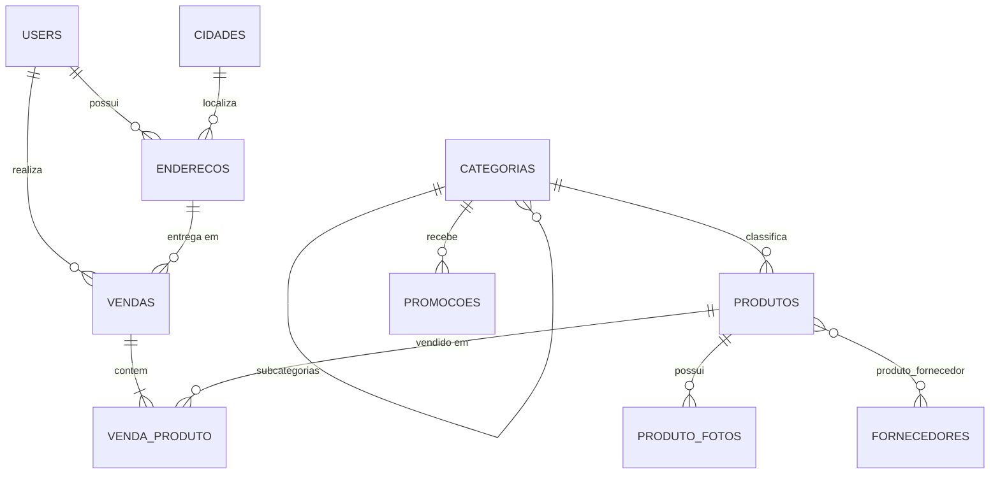

# 💊 UltraMed Farma — E-commerce Farmacêutico


A **UltraMed Farma** é um sistema web de e-commerce farmacêutico desenvolvido em Laravel, que permite aos clientes comprar medicamentos e produtos de perfumaria e higiene sem sair de casa. Os pagamentos são processados pelo **CaçaPay** e as entregas são gerenciadas e rastreadas pelo **CaçaLog**, dois sistemas externos integrados via API.

O foco do projeto é demonstrar boas práticas de desenvolvimento web back-end, modelagem relacional, integração entre sistemas (HTTP Client e webhooks) e construção de um dashboard gerencial para apoio à decisão.

> **Contexto acadêmico:** Programação Web · Prof. Cristiano Garcia · IFSC - Câmpus Caçador/SC

---

## 📌 Visão Geral do Projeto

O sistema é dividido em três módulos principais:

| Módulo | Descrição |
| --- | --- |
| **Loja (Cliente)** | Catálogo com filtro por categoria, carrinho, finalização de compra, endereços de entrega e acompanhamento de pedidos |
| **Painel Administrativo** | CRUDs de produtos, categorias, fornecedores, promoções e cidades, além do dashboard gerencial com gráficos |
| **Integrações** | Pagamento via **CaçaPay** e logística via **CaçaLog**, com webhook para atualização de status de entrega |

O controle de acesso é feito por middlewares (`admin` e `cliente`) a partir do campo `role` do usuário.

## ✨ Funcionalidades

### 🛍️ Área do Cliente

- Cadastro e login
- Catálogo de produtos com filtro por categoria e página de detalhes (por `slug`)
- Preços com desconto aplicados automaticamente quando há promoção vigente na categoria
- Carrinho de compras (armazenado na sessão) com validação de estoque
- Cadastro de múltiplos endereços de entrega
- Pagamento integrado com o CaçaPay
- Acompanhamento de pedidos com timeline de status de pagamento e entrega

### 🧑‍💼 Área Administrativa

- Dashboard gerencial com gráficos e filtro por período
- CRUD de produtos, com upload de até 5 fotos por produto (JPEG/PNG, até 2 MB cada)
- CRUD de categorias, com suporte a subcategorias
- CRUD de fornecedores
- CRUD de promoções (por categoria, desconto percentual ou absoluto, com validade)
- CRUD de cidades

## 🏗️ Arquitetura do Fluxo de Compra

```
Cliente (carrinho na sessão)
   ↓
Finalizar compra → seleção do endereço de entrega
   ↓
POST /api/compras  →  CaçaPay (valida CPF e saldo)
   ↓ aprovado
Venda criada (status_pagamento = aprovado) + baixa de estoque
   ↓
POST /api/entregas →  CaçaLog (registra a entrega)
   ↓
Webhook  POST /api/entrega/status  ←  CaçaLog
   ↓
status_entrega da venda atualizado automaticamente
```

> Se a compra for negada pelo CaçaPay, nenhuma venda é criada. Se o CaçaLog estiver indisponível, a venda é mantida e o erro é registrado em log.

## 🔌 Integrações

O sistema depende de dois serviços externos rodando localmente:

| Sistema | Porta | Função |
| --- | --- | --- |
| UltraMed Farma | 8000 | Sistema de gerenciamento (este projeto) |
| CaçaPay | 8001 | Processamento de pagamentos |
| CaçaLog | 8002 | Logística e rastreamento de entregas |

### CaçaPay

- **Endpoint:** `POST /api/compras`
- **Fluxo:** ao finalizar a compra, o sistema envia ao CaçaPay o CPF do cliente e o valor total. Se o cliente não existir, ele é criado com saldo promocional de R$ 50,00. Se existir com saldo suficiente, o valor é descontado. Caso contrário, a compra é negada.

### CaçaLog

- **Endpoint de envio:** `POST /api/entregas`
- **Fluxo:** após a aprovação do pagamento, o sistema registra a entrega com os dados do destinatário, endereço, CEP e conteúdo do pedido.
- **Webhook de retorno:** `POST /api/entrega/status`
  O CaçaLog notifica o sistema via callback sempre que o status da entrega é atualizado, e o campo `status_entrega` da venda é atualizado automaticamente.

**Status de entrega possíveis (enviados pelo CaçaLog):**

| Status | Descrição |
| --- | --- |
| Pendente | Aguardando designação |
| Saiu para entrega | Designado a um motoboy |
| Em Trânsito | Em rota de entrega |
| Entregue | Entregue ao destinatário |
| Cancelado | Cancelado |
| Devolvido | Devolvido ao remetente |

## 🗃️ Modelo de Dados



## 📊 Dashboard Gerencial

O dashboard administrativo (`/admin/dashboard`) utiliza **Chart.js** e permite filtrar todas as métricas por período (padrão: últimos 30 dias).

<!-- Adicione um print do dashboard e descomente a linha abaixo, ajustando o nome do arquivo -->
<!--  -->

## 📈 Principais KPIs

- Total de vendas no período
- Faturamento total no período
- Novos clientes cadastrados no período
- Faturamento e quantidade de vendas por dia *(gráfico de linha/barras)*
- Top 5 produtos mais vendidos *(gráfico de barras)*
- Distribuição de vendas por categoria *(gráfico de rosca)*
- Alerta de produtos com estoque baixo *(menos de 10 unidades)*

## 🛠️ Tecnologias Utilizadas

- **PHP 8.2+** com **Laravel 12**
- **MySQL**
- **Laravel Sanctum**
- **Laravel HTTP Client** (integração com CaçaPay e CaçaLog)
- **Blade** (templates)
- **Bootstrap 5** + Bootstrap Icons
- **Chart.js** (gráficos do dashboard)
- **Git & GitHub**

## 📁 Estrutura do Repositório

```
.
├── app/
│   ├── Http/
│   │   ├── Controllers/
│   │   │   ├── Admin/          # CRUDs do painel administrativo
│   │   │   ├── Api/            # Webhook do CaçaLog
│   │   │   ├── Cliente/        # Carrinho, vendas e endereços
│   │   │   ├── AuthController.php
│   │   │   └── HomeController.php   # Loja e dashboard
│   │   └── Middleware/         # AdminMiddleware e ClienteMiddleware
│   ├── Models/                 # Eloquent models
│   └── services/               # Serviços auxiliares (logística)
├── config/
│   ├── cacapay.php             # URL e token do CaçaPay
│   └── cacalog.php             # URL e token do CaçaLog
├── database/
│   ├── migrations/
│   └── seeders/                # Categorias, produtos, fornecedores, cidades e clientes de teste
├── resources/views/            # Views Blade (admin, cliente, auth e loja)
├── routes/
│   ├── web.php                 # Rotas da loja, cliente e admin
│   └── api.php                 # Webhook de status de entrega
├── tests/
└── README.md
```

## ⚙️ Reprodutibilidade

### Pré-requisitos

- PHP 8.2+ e Composer
- MySQL
- CaçaPay (porta 8001) e CaçaLog (porta 8002) em execução, para o fluxo completo de compra e entrega

### Instalação

```bash
# 1. Clonar o repositório
git clone https://github.com/ramonlodi/gestao-farmacia.git
cd gestao-farmacia

# 2. Instalar as dependências
composer install

# 3. Criar o arquivo .env (veja o modelo abaixo) e gerar a chave da aplicação
php artisan key:generate

# 4. Criar o banco de dados e rodar as migrations + seeders
php artisan migrate
php artisan db:seed

# 5. Expor as fotos dos produtos
php artisan storage:link

# 6. Subir o servidor
php artisan serve
```

### Variáveis de ambiente (`.env`)

```env
APP_URL=http://127.0.0.1:8000

DB_CONNECTION=mysql
DB_HOST=127.0.0.1
DB_PORT=3306            # ajuste conforme o seu MySQL (ex.: 3307)
DB_DATABASE=ultramed
DB_USERNAME=root
DB_PASSWORD=

CACAPAY_URL=http://127.0.0.1:8001
CACAPAY_TOKEN=

CACALOG_URL=http://127.0.0.1:8002
CACALOG_TOKEN=
```

### Dados iniciais

O seeder (`php artisan db:seed`) cria categorias e subcategorias, fornecedores, cidades de Santa Catarina, produtos de exemplo e 5 clientes de teste (`maria@teste.com`, `joao@teste.com`, `ana@teste.com`, `pedro@teste.com` e `lucia@teste.com`, todos com a senha `123456`), com um histórico de vendas para alimentar o dashboard.

O `VendaSeeder` é opcional e pode ser executado separadamente com `php artisan db:seed --class=VendaSeeder`.

### Usuários

**Administrador** — o seeder não cria o administrador. Crie-o via Tinker:

```bash
php artisan tinker
```

```php
App\Models\User::create([
    'nome' => 'Administrador',
    'email' => 'admin@farmacia.com',
    'password' => Hash::make('sua-senha-aqui'),
    'role' => 'admin',
]);
```

| Campo | Valor |
| --- | --- |
| E-mail | admin@farmacia.com |
| Senha | *(definida por você no passo acima)* |
| Acesso | Painel administrativo completo |

**Cliente** — cadastro pela tela de registro (CPF obrigatório, usado na cobrança via CaçaPay) ou uma das contas de teste listadas acima.

| Campo | Valor |
| --- | --- |
| Acesso | Loja, carrinho, pedidos e endereços |

## ✅ Requisitos Implementados

### Parte 1

- [x] Cadastro de clientes
- [x] Cadastro de categorias (com subcategorias)
- [x] Cadastro de produtos (com slug, estoque e categoria)
- [x] Upload de fotos de produtos (máx. 5 por produto)
- [x] Cadastro de cidades
- [x] Cadastro de endereços
- [x] Cadastro de vendas
- [x] Cadastro de fornecedores
- [x] Cadastro de promoções
- [x] Middleware para controle de acesso (admin / cliente)
- [x] Sistema de login
- [x] Interface e-commerce com carrinho via session

### Parte 2

- [x] Dashboard gerencial com gráficos
- [x] Integração com CaçaPay (pagamento por CPF com validação de saldo)
- [x] Integração com CaçaLog (registro de entrega)
- [x] Webhook para receber atualizações de status do CaçaLog
- [x] Campo `status_entrega` na venda
- [x] Campo `status_pagamento` na venda
- [ ] Tela de configuração (URLs e tokens no banco) — *atualmente configurados via `.env`*
- [x] Monitoramento com Google Analytics

## 🎯 Objetivo Profissional do Projeto

Este projeto tem como objetivo demonstrar habilidades em:

- Desenvolvimento web back-end com PHP e Laravel
- Modelagem de dados relacional (migrations, relacionamentos e seeders)
- Integração entre sistemas via API REST e webhooks
- Controle de acesso e autenticação por perfis
- Visualização de dados e construção de dashboards gerenciais

## 👤 Autor

Desenvolvido por **Ramon Lodi de Sousa** 🚀
[GitHub](https://github.com/ramonlodi) · [LinkedIn](https://linkedin.com/in/ramonlodi)

## 📄 Licença

Distribuído sob a licença MIT. Veja o arquivo [LICENSE](LICENSE) para mais detalhes.
